# LAB-2678: Accelerating Incident Investigation with IBM Concert Operate

**IBM TechXchange 2026, Shared Cluster Edition.** Author: Raghu Hulgundi (raghu.hulgundi@ibm.com)

> **Note:** This copy of the guide does not include the lab environment's addresses or credentials. Your instructor
> provides the Concert Operate URL, the bastion host name and port, and your user name and password.
> A PDF version is in the repository: [LAB-2678-Student-Guide.pdf](../LAB-2678-Student-Guide.pdf).

## Table of Contents

- [1 Introduction](#1-introduction)
  - [1.1 Lab Content](#11-lab-content)
  - [1.2 Working on a Shared Cluster](#12-working-on-a-shared-cluster)
- [2 Lab Environment](#2-lab-environment)
  - [2.1 Accessing your Lab Environment](#21-accessing-your-lab-environment)
  - [2.2 Your Student Kit](#22-your-student-kit)
  - [2.3 Warm-up: Send your First Events](#23-warm-up-send-your-first-events)
- [3 Event and Alert Terminology](#3-event-and-alert-terminology)
- [4 Meet the AI: One Incident, Start to Finish](#4-meet-the-ai-one-incident-start-to-finish)
  - [4.1 The Situation](#41-the-situation)
  - [4.2 How the Incident was Created](#42-how-the-incident-was-created)
  - [4.3 From 17 Alerts to One Group, Ranked](#43-from-17-alerts-to-one-group-ranked)
  - [4.4 Probable Cause, Past Tickets and the Runbook](#44-probable-cause-past-tickets-and-the-runbook)
  - [4.5 Affected Resources](#45-affected-resources)
  - [4.6 Incident Summary (Generative AI)](#46-incident-summary-generative-ai)
  - [4.7 Diagnosis Agent (Agentic AI)](#47-diagnosis-agent-agentic-ai)
  - [4.8 The AI Behind It](#48-the-ai-behind-it)
- [5 Topology](#5-topology)
  - [5.1 Creating Observer Jobs](#51-creating-observer-jobs)
  - [5.2 Merge Rules in Action](#52-merge-rules-in-action)
  - [5.3 Exact Group Template](#53-exact-group-template)
  - [5.4 Dynamic Group Template](#54-dynamic-group-template)
  - [5.5 Applications and Business Criticality](#55-applications-and-business-criticality)
- [6 Scope-based Correlation](#6-scope-based-correlation)
  - [6.1 Submit Events with no Scope-based Policy](#61-submit-events-with-no-scope-based-policy)
  - [6.2 Create a Scope-based Event Grouping Policy](#62-create-a-scope-based-event-grouping-policy)
  - [6.3 Submit Events with the Scope-based Policy Enabled](#63-submit-events-with-the-scope-based-policy-enabled)
- [7 Temporal Correlation](#7-temporal-correlation)
  - [7.1 Review your Temporal Policies](#71-review-your-temporal-policies)
  - [7.2 Test your Temporal Policies](#72-test-your-temporal-policies)
- [8 Topological Correlation](#8-topological-correlation)
  - [8.1 Validate Topological Correlation](#81-validate-topological-correlation)
  - [8.2 Alert Roll-up to the Application](#82-alert-roll-up-to-the-application)
- [9 Optional Extras: If You Finish Early](#9-optional-extras-if-you-finish-early)
  - [9.1 Tag Group Template](#91-tag-group-template)
  - [9.2 Token Group Template](#92-token-group-template)
- [10 Lab Recap](#10-lab-recap)
- [11 Troubleshooting](#11-troubleshooting)
- [12 Feedback section](#12-feedback-section)
- [13 Lab Reference Materials](#13-lab-reference-materials)
  - [13.1 Concert Operate Documentation](#131-concert-operate-documentation)
  - [13.2 IBM TechXchange Community](#132-ibm-techxchange-community)
  - [13.3 Big Blue Helps on YouTube](#133-big-blue-helps-on-youtube)

## 1 Introduction

In today's complex IT environments, managing operations effectively has become a mission-critical challenge. Enterprises operate across hybrid cloud landscapes, using a patchwork of tools and technologies that create silos, increase noise, and slow down response times to incidents and outages. To address these growing challenges, **IBM Concert Operate** emerges as a **strategic solution** that transforms how IT Operations teams manage and respond to incidents across the connected enterprise.

Originally coined by Gartner as a new category in 2016, AIOps (short for **Artificial Intelligence for IT Operations**) is now evolving into what IBM defines as an **Event Intelligent Solution (EIS)**. This shift reflects the increasing need for **AI-driven, unified operations management**, not just isolated observability or event correlation.

#### What is Concert Operate?

IBM Concert Operate is a **next-generation platform** that uses **advanced, explainable AI** to unify, analyze, and automate the handling of operational data across IT systems. It ingests millions of events per day, then applies intelligent correlation, context, and prioritization to drastically **reduce noise**, eliminate redundant alerts, and **highlight the incidents that matter most**.

Key capabilities include:

- **Topology-first approach**: Dynamic maps that provide real-time visibility into system relationships and service impact.
- **Probable cause analysis**: Surfaces the most likely root cause of incidents using event and topology data.
- **Runbook automation**: Converts insights into action by automating response workflows and remediation steps.

These capabilities not only reduce Mean Time to Resolution (MTTR), but also **minimize manual effort**, **increase service availability**, and improve alignment between ITOps, SREs, and business stakeholders.

#### Why it Matters

Legacy tools and fragmented monitoring approaches are no longer sustainable. Most organizations run more than ten monitoring tools, and many suffer from alert fatigue, war-room inefficiencies, and reactive firefighting. IBM Concert Operate breaks down these silos by delivering a **single platform with full-stack observability, AI-powered insights, and automated remediation**.

By shifting from **reactive to proactive and even predictive operations**, organizations can:

- Reduce support tickets by up to 70%
- Accelerate root cause identification
- Avoid outages through anomaly detection
- Enable smarter, faster decision-making with contextual awareness

### 1.1 Lab Content

In this Lab, we will focus on different capabilities that help IT Operations personnel with event and alert noise reduction, such as:

- Data Ingestion
  - Event and alert terminology
  - Sample events sent through a generic webhook
  - Topology data loaded with the File observer
- Topology configuration
  - Merge rules
  - Exact and dynamic resource group templates
  - Applications and business criticality
- AI-assisted incident investigation (look only): grouping, probable cause ranking, similar tickets, runbooks, incident summary, the diagnosis agent and the MCP server
- Incident investigation workflow
  - Scope-based alert correlation
  - Temporal alert correlation (your own history, on a model your instructor trained in advance)
  - Topological alert correlation and application roll-up

The lab takes about **90 minutes**. It should be executed in the order in which the steps are presented in this guide, as sections depend on work completed in prior sections.

| Section | Topic                                                    | Minutes             |
|---------|----------------------------------------------------------|---------------------|
| 2       | Lab environment and warm-up                              | 8                   |
| 3       | Event and alert terminology                              | 3                   |
| 4       | Meet the AI: a look-only tour of an AI-assisted incident | 15                  |
| 5       | Topology: load, merge, group, define an application      | 28                  |
| 6       | Scope-based correlation                                  | 15                  |
| 7       | Temporal correlation (pretrained, your own policies)     | 8                   |
| 8       | Topological correlation and application roll-up          | 9                   |
| 10      | Recap                                                    | 3                   |
| 9       | Optional extras                                          | If you finish early |

### 1.2 Working on a Shared Cluster

In this edition of the lab, all students work on **one shared Concert Operate cluster**. Your instructor has already created the event webhook, set up business criticality, and trained the temporal AI model, so you skip those steps. To keep your work separate from everyone else's, follow these rules:

- **Your student ID on everything:** every job, rule, template, policy and application you create starts with or contains your student ID. This guide writes your ID as **sNN**. Everywhere you see sNN, type your own ID (for example s07).
- **Touch only your own objects:** **never edit, run, disable or delete anything without your ID.**
- **Search before you select:** in the Alerts view, always type your ID in the search box before you select alerts. **Never "select all" on an unfiltered list, and never clear alerts that do not carry your ID.**
- **Never touch the AI models:** **never click Train, and never delete, retrain or redeploy the temporal model or any other AI model.** The temporal model is shared and already trained, with two policies for each student.
- **Never change policies that are not yours:** **never edit, enable, disable, archive or delete another student's or the product's policies,** **including the \[sNN\] temporal policies and the preset scope policies.**
- **Leave other myapp alerts alone:** **only the sNN-myapp alerts are yours.**

> **Note:** The screenshots in this guide were taken with the instructor's test ID (s00 or s01) or with the original lab names (router1, computer1000, NetCash). Wherever a screenshot shows s00, your screen shows your own ID. Every name you type starts with your student ID, for example **s07-router1**.

## 2 Lab Environment

In this Lab, you will use three systems:

**Student Desktop:** a standard Windows desktop. You use its browser to log in to the Concert Operate console, and its PowerShell to connect to the bastion host and to copy your topology files.

**Bastion Host:** a shared Red Hat Enterprise Linux (RHEL) server. You log in with your own student account. Your student kit is already in your home folder, and you use it to send events to Concert Operate.

**OpenShift Cluster:** one Red Hat OpenShift cluster running IBM Concert Operate 5.2, shared by the whole class.

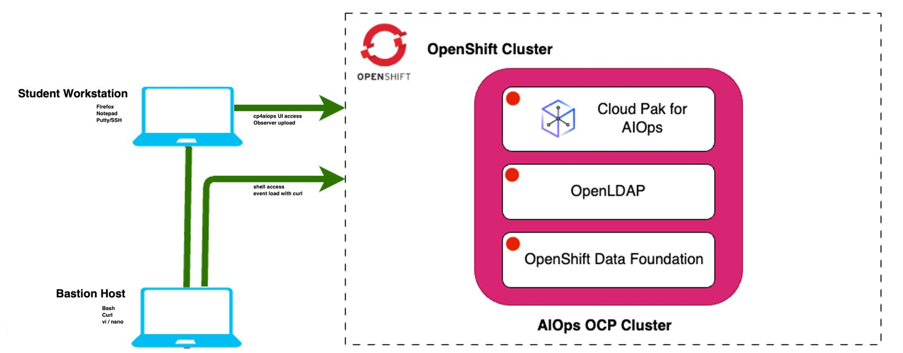

### 2.1 Accessing your Lab Environment

Your instructor gives you a sign-in slip with your **student ID** (sNN), your **user name** (studentNN) and **password**, the **Concert Operate URL**, and the **bastion host name and SSH port**.

> **Note:** This copy of the guide does not include the lab environment's addresses. Your instructor provides the **Concert Operate URL**, the **bastion host name and port**, and your **user name and password**. In the commands below, replace **\<bastion-host\>** and **\<port\>** with the values you are given.

1.  **Log in to Concert Operate:** open the browser on the student desktop, go to the Concert Operate URL and on the login page choose **Enterprise LDAP** as the login method (not the default IBM provided credentials), then sign in as studentNN with the password on your sign-in slip. You land on the Concert Operate home page.

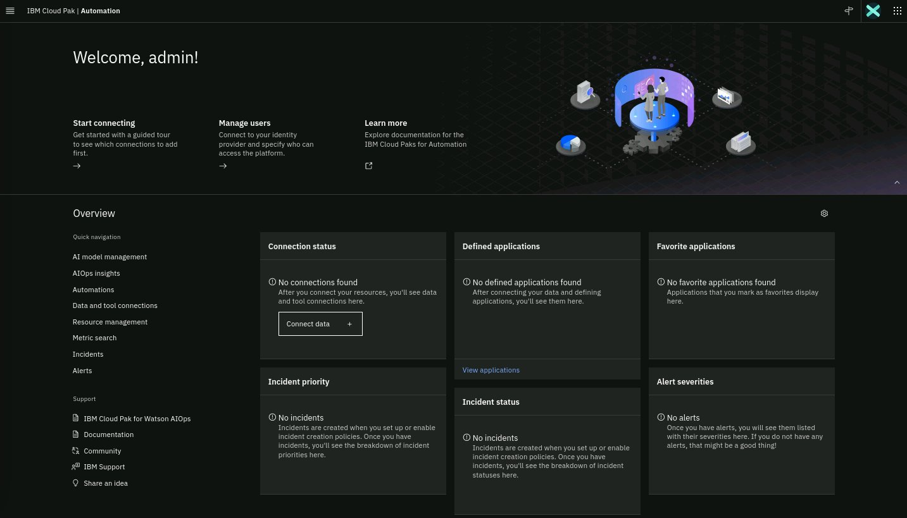

2.  **Log in to the bastion:** on the student desktop, open **PowerShell** (Start menu, type powershell) and run the following, using the same password (answer **yes** if asked to trust the host). Keep this window open: it is your **bastion window** for sending events.

<!-- -->

    ssh -p <port> studentNN@<bastion-host>
    cd ~/lab

3.  **Copy your topology files to the desktop:** in Section 5 (Topology) the browser uploads them from this desktop. Open a **second** PowerShell window and run these commands one at a time (**-P** must be upper case for scp):

<!-- -->

    mkdir $HOME\lab-sNN
    cd $HOME\lab-sNN
    scp -P <port> studentNN@<bastion-host>:lab/*.txt .

Your three topology files and README.txt are now in the **lab-sNN** folder in your user folder. A new folder keeps them separate from files left on this desktop by earlier sessions. You can close this second window now: from here on you need only the browser and your bastion window.

### 2.2 Your Student Kit

Open **README.txt** from the **lab-sNN** folder in Notepad and keep it open: it has every name you will type, with your ID filled in, ready to copy and paste. The table below lists your files; the .json files are sent for you by send-events.sh.

| File                                                              | What it is                                           | Used in                                                       |
|-------------------------------------------------------------------|------------------------------------------------------|---------------------------------------------------------------|
| sNN-infrastructure.txt, sNN-application.txt, sNN-application2.txt | Topology data                                        | Section 5 (Topology), uploaded from the desktop               |
| sNN-topology-events-network.json                                  | 3 events: computer, router, firewall                 | Section 2.3 (Warm-up) and Section 8 (Topological Correlation) |
| sNN-scope-events.json                                             | 8 events: DB2, Liberty, API in 3 regions             | Section 6 (Scope-based Correlation)                           |
| sNN-temporal-events.json                                          | 4 events on your sNN-myapp                           | Section 7 (Temporal Correlation)                              |
| sNN-topology-events-app.json                                      | 3 events: computer, billing, webserver               | Section 8 (Topological Correlation)                           |
| send-events.sh                                                    | Sends an event file to the lab webhook               | Run it in your bastion window                                 |
| README.txt                                                        | Your ID, your event day and every name you will type | Keep it open in Notepad                                       |

### 2.3 Warm-up: Send your First Events

> **Why this matters:** You send 3 alerts on resources that Concert Operate does not know yet, so they arrive as 3 separate, ungrouped alerts. Keep this picture in mind: in Section 8 (Topological Correlation) you send the same alerts again after building the topology, and they arrive as one group. The difference is the topology you build in between.

1.  In your bastion window, run:

<!-- -->

    ./send-events.sh sNN-topology-events-network.json

For example, student s01 sees this. Each event must end in HTTP 200 or 202. Anything else: raise your hand.

> **Tip:** the cluster is shared by the whole class, so new alerts can take a minute or two to appear. Wait, then click **Refresh alerts** before deciding something is wrong. This applies every time you send events in this lab.

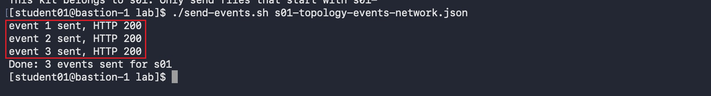

2.  Switch back to the browser with the Concert Operate console. If your session timed out, log in again as studentNN with **Enterprise LDAP**.
3.  Click the (1) **Navigation menu** icon in the top-left and navigate to: **Operate → (2) Alerts**.

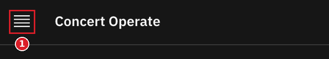

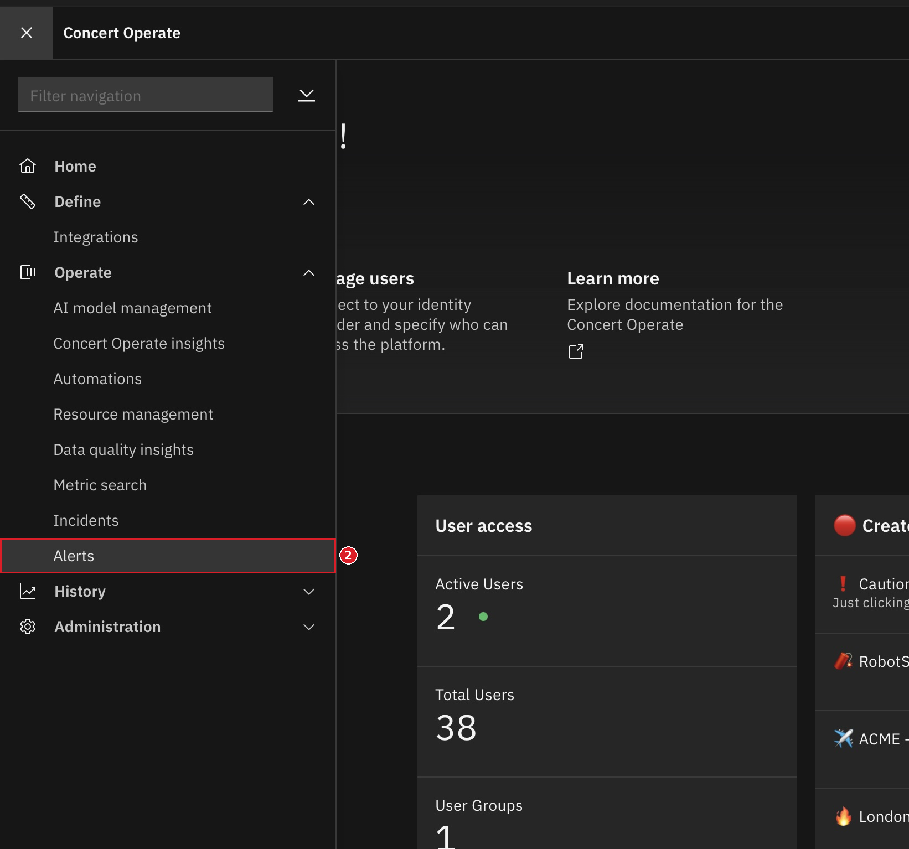

4.  Type your ID, **sNN**, in the (1) search box and click the (2) **Refresh alerts** icon next to it. You should see 3 alerts on sNN-computer1000, sNN-router1 and sNN-greatFireWallOfSecurity.

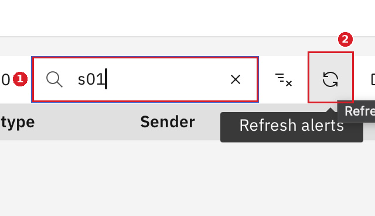

5.  Let's add some color to this page: click the gear icon on the right, select **User preferences**, turn the **Row coloring** slider On (green) and click **Save**.

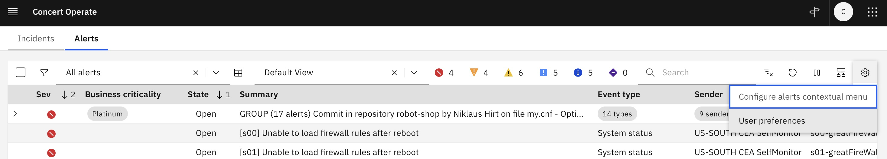

6.  Click the (1) **View correlation** icon in the top-right. The (2) Correlation column is empty for all 3 alerts (example for s01).

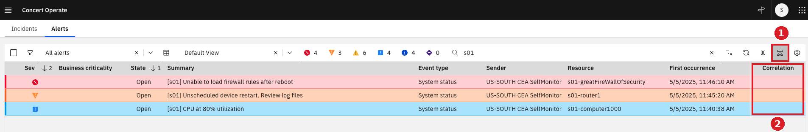

7.  With the search still set to sNN, click the **checkbox at the top-left** of the list to select all your alerts, right-click and select **Clear**. They change state from Open to Clear and then to Closed, and disappear after 2 to 3 minutes. Move on without waiting. **Never use the select-all checkbox with an empty search box: it would clear every student's alerts.**

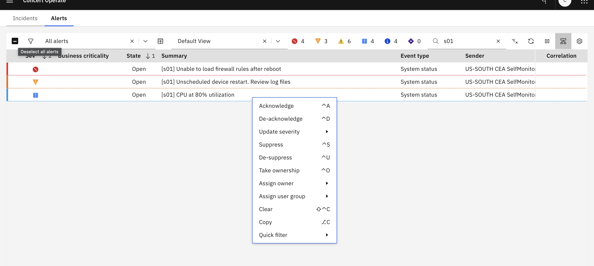

## 3 Event and Alert Terminology

Let us define some key Concert Operate concepts and terms that will help you understand the Lab:

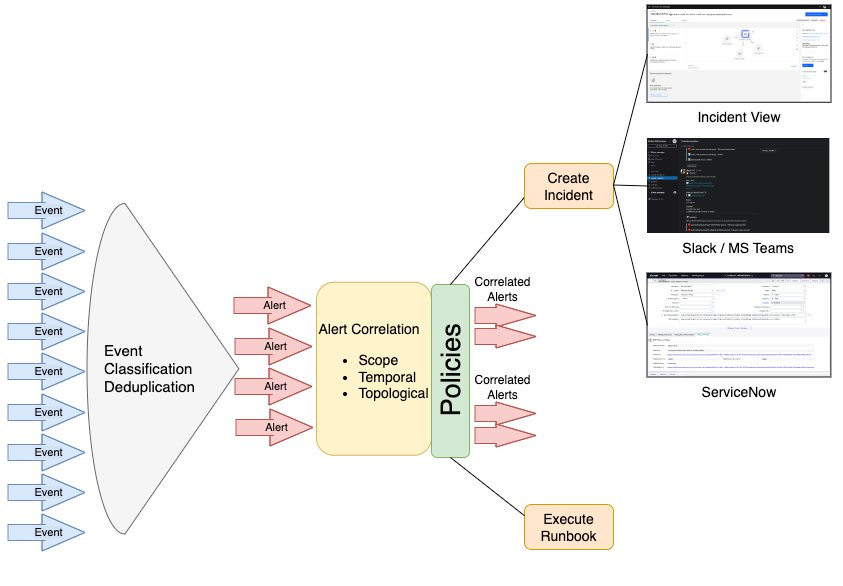

**Events:** An event is a record containing structured data summarizing key attributes of an occurrence on a managed entity, which might be a network resource, some part of that resource, or other key element associated with your network, services, or applications. An event may or may not indicate something anomalous and is a point-in-time, immutable statement about the managed entity in question.

**Alerts:** Alerts are created when one or more events indicate an anomalous condition. Alerts represent an ongoing anomalous condition against a single managed entity. Unlike events, alerts might evolve over time as the condition changes. Alerts have state which can be Open, Clear, or Closed. Concert Operate automatically correlates alerts to determine which alerts are likely to share a common cause.

**Event Deduplication:** Occurrences of the same event are deduplicated into a single alert instance. The default deduplication key is built from {{ event.resource }}-{{ event.type.classification }}-{{ event.type.condition }}. When the same event occurs again, the event count of the current alert increases instead of creating a new alert. This is why every resource name in your kit carries your student ID: your events never deduplicate into another student's alerts.

**Alert groups:** two or more alerts that Concert Operate has correlated because they belong together. In this lab you will see three ways alerts get grouped:

| Correlation type | What links the alerts                                                                                               |
|------------------|---------------------------------------------------------------------------------------------------------------------|
| Scope-based      | The alerts match a scope you define (for example the same location and application) and occur within a time window. |
| Temporal         | The system learned from past alerts that these alerts tend to occur together.                                       |
| Topological      | The alerts occur on resources in the same topology resource group.                                                  |

## 4 Meet the AI: One Incident, Start to Finish

Before you build anything, walk through a real incident on this cluster and see what Concert Operate's AI does with it. The RobotShop demo application (a web shop with web, catalogue and ratings services and a MySQL database on Kubernetes) had a bad evening: 17 alerts from 11 different tools in 14 minutes. You follow the incident from the first alert to the proposed fix. Everything in this section is **look only**.

> **Why this matters:** Every grouping method you build later in this lab (topology, scope, temporal) is part of what turned those 17 alerts into one incident. Seeing the finished result first shows you where the lab is heading, and introduces the AI features that sit on top: ranking, similar tickets, runbooks, incident summary, the diagnosis agent and the MCP server.

> **Look only: all 30 students open this same incident.** You may open tabs, expand rows and hover. Do not click **Edit**, **Priority**, **Status**, **Assignees**, **Generate incident summary**, **Re-run diagnosis**, **Run** (runbook), **Add tickets to incident** or **Clear alert**, and do not change or save views and filters. One click from one student changes the incident for everyone.

### 4.1 The Situation

At 23:26 UTC a developer commits a change to the database configuration file my.cnf ("Optimise Buffer Pool"). Over the next 14 minutes the alerts pile up:

| Time (UTC) | What the tools report                                                                                       |
|------------|-------------------------------------------------------------------------------------------------------------|
| 23:26      | GitLab: commit to my.cnf on mysql-db                                                                        |
| 23:30      | Metric anomaly detection: latency, pod restarts and transactions per second off normal on ratings and mysql |
| 23:31      | Jenkins pipeline success, ArgoCD deployment running, Instana: innodb_buffer_pool_size changed               |
| 23:32      | Falco: database restarted. Instana: **database not responding** (critical)                                  |
| 23:35      | MySQL memory at 98%, latency 1050 ms                                                                        |
| 23:38      | ELK log: "Connection refused". Instana: ratings error rate too high                                         |
| 23:39      | Catalogue error rate too high. Turbonomic: resize the buffer pool from 1 GB to 2 GB                         |
| 23:40      | Selenium: web functional test failed. Instana: **sudden increase in erroneous calls on ratings** (critical) |

Without help, an operator sees 17 alerts from 11 tools. Which one do you work on first?

1.  Open the **Navigation menu** and navigate to (1) **Operate → Incidents**. ((2) **AI model management** is described at the end of this section.)

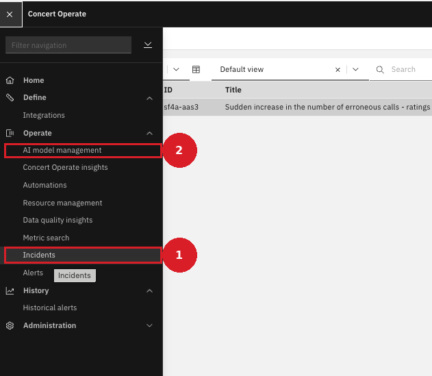

2.  The incident list shows one incident: (1) priority **P1**, (2) **Sudden increase in the number of erroneous calls - ratings**, (3) **17** alerts, (4) first occurrence. Click the title (2) to open it.

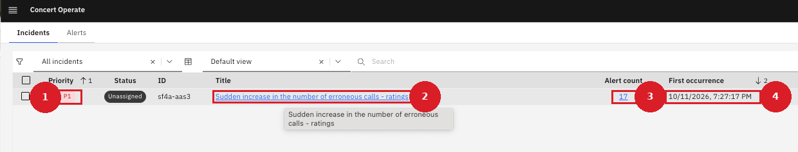

### 4.2 How the Incident was Created

On the **Overview** tab, look at the left panel.

1.  \(1\) **Source**: **Golden signal and persistence story creation**, a default incident policy. Its rule: open an incident when an alert is **Major or Critical** and its golden signal is an **effect**, a symptom that users feel. **Database not responding** is critical, but its golden signal is a *cause*, so it did not open an incident by itself. **Sudden increase in the number of erroneous calls - ratings** is critical and an *effect*: users are hurt, so the policy opened a Priority 1 incident and named it after that alert.
2.  \(2\) **Notifications**: the incident links to a ServiceNow ticket (INC0010003) and a Slack channel. On this demo cluster those integrations are simulated (the links open demo pages), but the flow is the real one.

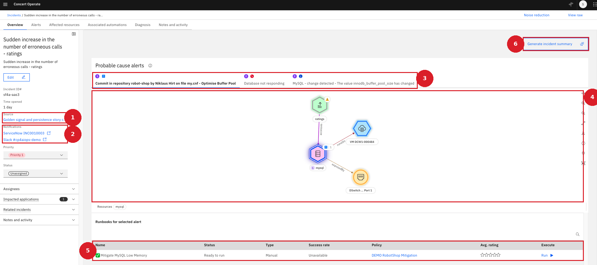

The rest of this page is covered in the next steps: (3) and (4) the probable cause alerts, (5) the runbook, and (6) **Generate incident summary**, which you must **not click**.

### 4.3 From 17 Alerts to One Group, Ranked

1.  Click the (1) **Alerts** tab. All 17 alerts sit in one group: (2) **GROUP (17 alerts)**, 14 types, 9 senders, 10 resources. The grouping came from the methods you build later: topological group and topological path correlation (the resources are linked in the RobotShop topology), temporal correlation (these alerts happened together before) and scope-based correlation.
2.  \(3\) **Business criticality**: every alert shows **Platinum**, inherited from the RobotShop application. You give your own application the same criticality in Section 5.5.
3.  \(4\) **Ranking**: the probable cause rank of each alert, 1 being the most likely cause. Compare two rows:

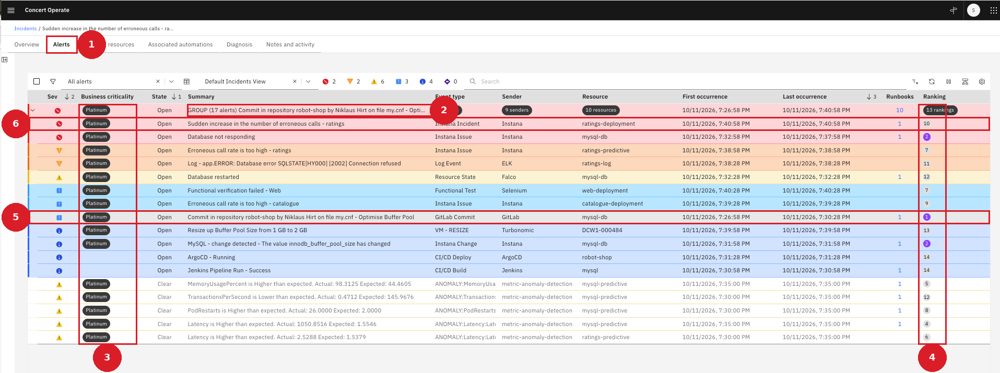

| Rank   | Alert                                                                                                 | Severity    | Why it ranks there                                                                                                                                                                             |
|--------|-------------------------------------------------------------------------------------------------------|-------------|------------------------------------------------------------------------------------------------------------------------------------------------------------------------------------------------|
| **1**  | \(5\) GitLab commit to my.cnf "Optimise Buffer Pool" on mysql-db                                      | Warning     | Its words describe a change (commit, config file), it happened **first**, and mysql-db sits at the centre of the topology paths that connect the other alerts. Low severity counts for little. |
| 2      | Instana: innodb_buffer_pool_size changed                                                              | Information | A configuration change on the same database                                                                                                                                                    |
| 3      | Database not responding                                                                               | Critical    | An error on the database, high severity, on the path                                                                                                                                           |
| **10** | \(6\) Sudden increase in the number of erroneous calls - ratings (the alert that opened the incident) | Critical    | Highest severity, but it happened **last** and describes a symptom                                                                                                                             |

> **Why the ranking matters:** the alert that woke everyone up is ranked 10th; a quiet configuration commit 14 minutes earlier is ranked 1st. The ranking scores each alert on what happened first, what its words say (change, commit, error), where its resource sits in the topology and its severity, and puts the likely cause on top, so the SRE starts with the database change instead of chasing the symptom on ratings.

### 4.4 Probable Cause, Past Tickets and the Runbook

1.  Go back to the **Overview** tab. (3) **Probable cause alerts** shows the top 3 ranked alerts, and (4) draws them on the topology: ratings accesses mysql, mysql runs on VM DCW1-000484 and is exposed by a switch port. Click each of the three alert names to move between them.
2.  \(5\) **Runbooks for selected alert**: with the rank 1 alert selected, the runbook **Mitigate MySQL Low Memory** is attached by the policy **DEMO RobotShop Mitigation**, type Manual, ready to run. **Do not click Run: it would act on the shared demo application for everyone.**
3.  Scroll down to (1) **Similar past resolution tickets**. The **Similar incidents** model searched past ServiceNow tickets and found matches such as (2) **RobotShop sudden increase in the number of erroneous calls**. (3) Its resolution: *MySQL Deployment was out of Memory. Resolved by increasing memory and restarting mysql pod.* The AI underlines the action words (increasing memory, restarting mysql pod). **Do not click (4) Add tickets to incident.**

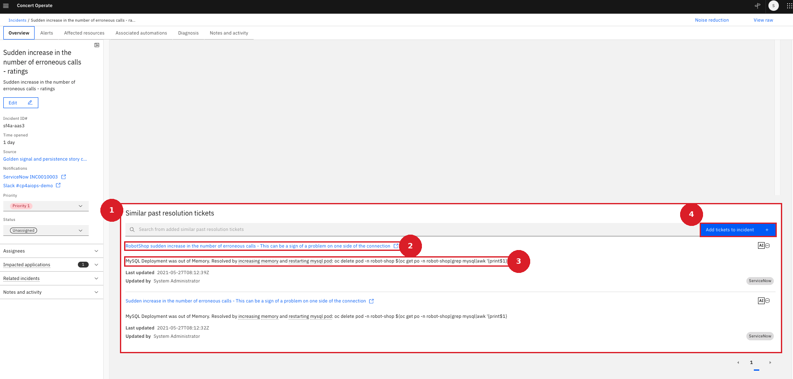

> **Why this matters:** cause, past fix and an approved automation sit on one page. The past ticket says "out of memory, add memory, restart", which matches the rank 1 alert (a buffer pool change on mysql), and the runbook to apply it is ready. That closed loop is what cuts the time to resolve.

### 4.5 Affected Resources

The **Affected resources** tab (1) shows the blast radius on one picture (2): web, catalogue, ratings, mysql and the VM it runs on, each with its alert count and severity, plus the Topology activity charts (3) you meet in Section 8.1. No need to open it now.

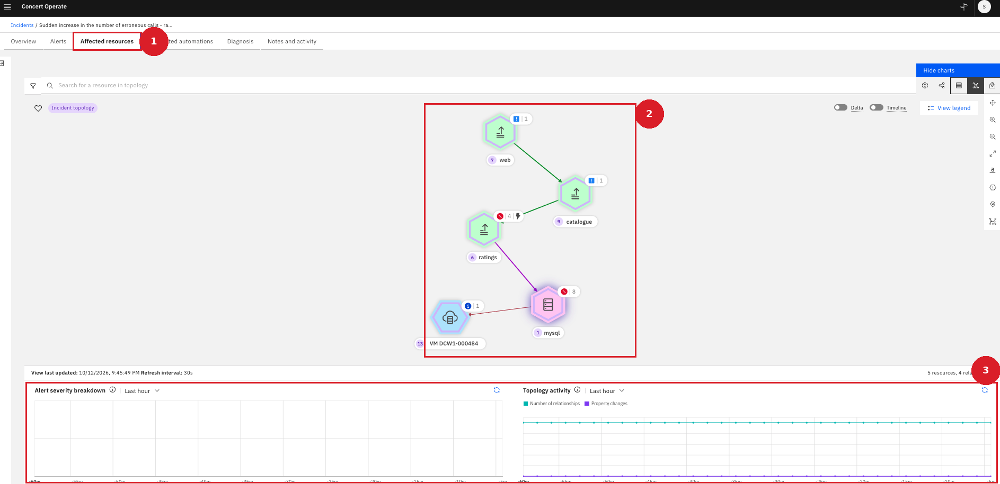

### 4.6 Incident Summary (Generative AI)

1.  Back on the **Overview** tab, the (1) **Incident summary** box at the top condenses the 17 alerts into a few sentences: critical erroneous calls and a database that is not responding, plus lower-severity latency, memory, pod restarts, a database restart and the innodb_buffer_pool_size change. **The summary is already generated: do not click Generate incident summary, and do not use the (2) copy, edit or regenerate icons.**

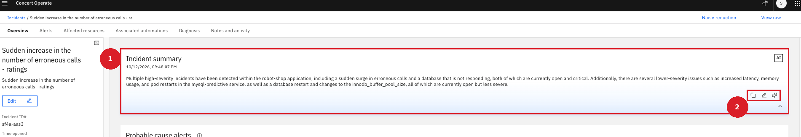

> **Why this matters:** the hand-over note for the next shift or a manager, written in seconds from the alerts. It is generated text, so read it as a draft: check it against the alerts.

### 4.7 Diagnosis Agent (Agentic AI)

1.  Click the **Diagnosis** tab. (1) **Agent diagnosis status**: the diagnosis agent already ran (Completed). **Do not click (2) Re-run diagnosis.**
2.  \(3\) **Analysis summary**: the agent evaluated 5 resources, used 1 alert and 1 change event, in about a minute. (4) **Investigation summary**: its conclusion in plain language.
3.  \(6\) **Investigated resources**: the agent walked the topology and labelled each resource **Primary failure** (ratings, catalogue, the Kubernetes cluster) or **Symptom** (mysql, a switch port). Expand (5) **View reasoning** and one resource to read the evidence it used.

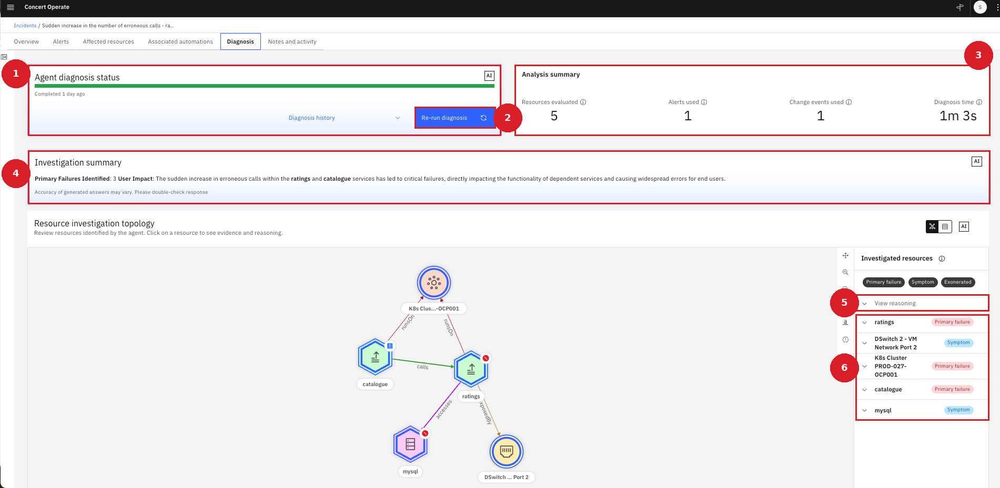

> **Discuss:** the agent's conclusion is not the same as the ranking, which points at the mysql configuration change. They used different evidence: the ranking scored all 17 alerts, while this agent run used 1 alert and 1 change event. That is why the page says "Accuracy of generated answers may vary": the AI proposes and shows its evidence, the SRE decides.

### 4.8 The AI Behind It

1.  These AI capabilities live under **Operate → AI model management**, one tile each. The table below lists them, so you do not need to open the page. If you do, look only: **do not click Train, Set up training, Deploy or Delete on any tile.**

| AI capability             | What it does                                                          | Where you saw it                            |
|---------------------------|-----------------------------------------------------------------------|---------------------------------------------|
| Temporal grouping         | Learns from history which alerts occur together                       | Grouping (you review it in Section 7)       |
| Metric anomaly detection  | Learns normal metric behaviour and raises alerts when metrics deviate | The latency, memory and transactions alerts |
| Similar incidents         | Matches an incident with past ITSM tickets                            | Similar past resolution tickets             |
| Change risk               | Scores how risky a change ticket is, from past changes                | (not in this incident)                      |
| Log anomaly golden signal | Finds anomalies in logs and tags them with golden signals             | (not set up on this cluster)                |
| Incident summarization    | Generative AI summary of an incident                                  | Incident summary                            |
| SRE agent                 | Investigates an incident across the topology                          | Diagnosis tab                               |
| Knowledge agent           | Chat assistant that answers questions from your documentation         | (not set up on this cluster)                |

> **The MCP server:** Concert Operate also exposes its data and actions through an **MCP (Model Context Protocol) server**. Incidents, alerts, topology, policies, runbooks and AI models become tools that an AI assistant, such as watsonx Orchestrate or any other MCP client, can call. An assistant connected this way can answer "what is the probable cause of this incident?", "which resources depend on mysql-db?" or "which runbooks apply to this alert?" from the same data you just explored. You do not connect anything in this lab: this is for information only.

**The story in one line:** 17 alerts from 11 tools, grouped into one incident by topology, path, temporal and scope correlation; opened because users were hurt; ranked so the quiet configuration change comes first; matched with a past ticket that says "out of memory, add memory, restart"; a runbook ready to apply; a summary written; an agent's investigation to weigh; and all of it reachable by other AI through MCP. In the rest of the lab you build the grouping methods yourself, for your own sNN resources.

## 5 Topology

The Resource Management capabilities in Concert Operate provide operations teams with up-to-date visibility and control over dynamic infrastructure and services. Topology information adds enormous value to your IT Operations: it lets you visualize an end-to-end view of the environment, create groups of resources that logically belong together, and perform topology-based correlation for alerts occurring within a group of related resources.

> **Why this matters:** Concert Operate correlates alerts best when it knows how your resources connect: which computer runs which application, which router it sits behind. That map is the topology. In production it is filled by observers and integrations that read from tools such as Kubernetes, VMware, ServiceNow or Instana.

A **Topology Observer** is a service that extracts resource information from a target source. In this Lab, we will use the **File Observer**. You will load three files from your kit, which hold 12 resources:

- **sNN-infrastructure.txt:** sNN-router1 uses sNN-greatFireWallOfSecurity. sNN-computer1000 is connected to the router and contains two CPUs (sNN-Intel and sNN-AMD). The person sNN-steve uses the computer.
- **sNN-application.txt:** the applications sNN-billing and sNN-webserver run on a second record of sNN-computer1000.
- **sNN-application2.txt:** sNN-notifications and sNN-email run on sNN-computer1001.

Each line of a file is one vertex. The "uniqueId" field must be unique within the topology, and "matchTokens" are the values that alerts are matched on. Yours all start with your ID, which keeps them apart from everyone else's.

### 5.1 Creating Observer Jobs

> **Why this matters:** This lab uses the File observer. It loads topology from a plain text file, so you can bring in resources from any source, even one that has no out-of-the-box observer or integration: a homegrown CMDB, a spreadsheet export or a script's output. It shows how flexible the product is: if you can write the data to a file, Concert Operate can model it.

1.  From the **Navigation menu** in the top-left navigate to: **Define → Integrations**.
2.  From the Integrations page, click on **Add integration**. Under **Category** click on **Topology**, search for **File**, click on the **File** tile and click **Get started**.

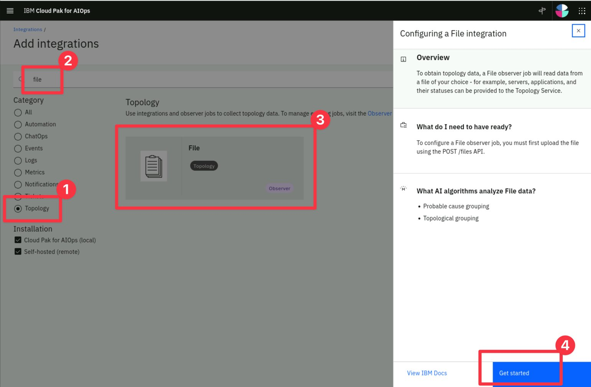

3.  In the **New Observer Job: File** form, open (1) **Choose your job type** and select **load** (not multi_file). Then fill in:
    - \(2\) **Unique ID:** sNN-infrastructure
    - **File mode:** keep **Upload local file**
    - \(3\) **Local file name:** drag **sNN-infrastructure.txt** from the lab-sNN folder in your user folder (copied in Section 2.1 (Accessing your Lab Environment)) onto **Drag and drop file here or click to upload**, or click it and browse to the file
    - \(4\) **Provider:** leave it empty. Concert Operate then uses FILE.OBSERVER:sNN-infrastructure.txt, which your merge rule needs in Section 5.2 (Merge Rules in Action).

    Click **Save**. The job runs the moment it is saved.

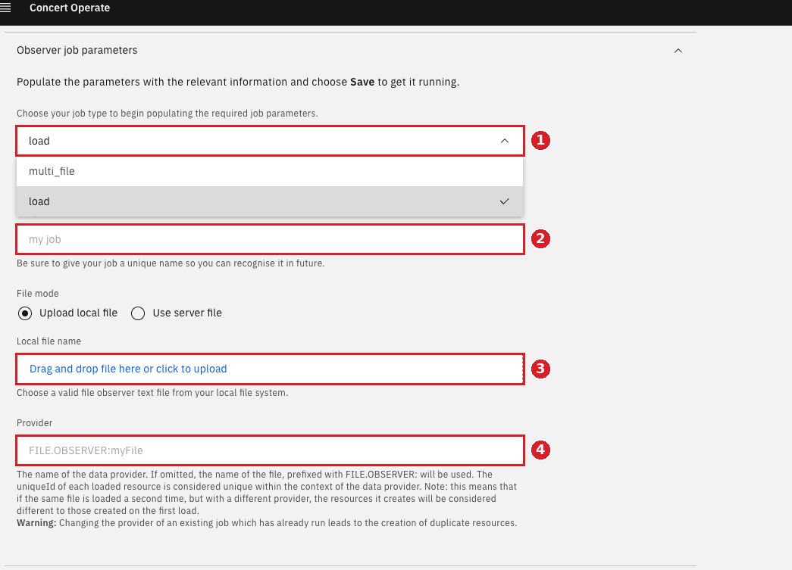

4.  Click on the (1) **Add a new job** button, choose the **File** observer, select job type **load** again and repeat the process with the Unique ID **sNN-application** and the file **sNN-application.txt**.
5.  Repeat once more (job type **load**) with the Unique ID **sNN-application2** and the file **sNN-application2.txt**.
6.  Verify that your three jobs show the (2) **Ready** status. Filter the list by your ID, because you will see everyone's jobs.

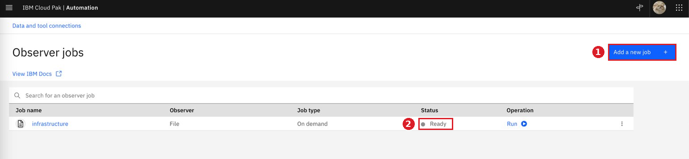

7.  From the **Navigation menu** navigate to: **Operate → Resource management**. Click on the (1) **Resources** tab and (2) search for **sNN-**. You should see 12 resources, including (3) **two** called sNN-computer1000: one from each file. We will merge them in the next step.

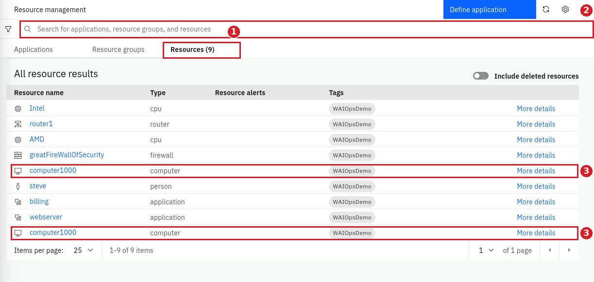

8.  Click on **sNN-router1**, increase the number of hops to **2** and click **Render** to see the infrastructure.

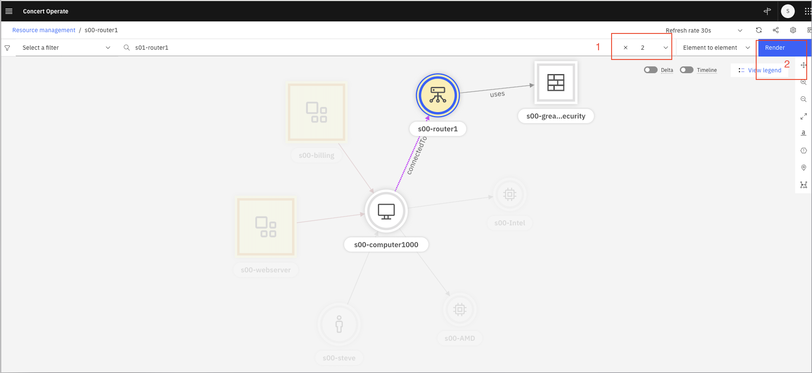

### 5.2 Merge Rules in Action

Different observers can record the same resource as two (or more) resources. A **merge rule** joins records that share a token into a single composite resource, so that infrastructure alerts and application alerts can be correlated together.

> **Why this matters:** Your infrastructure file and your application file both describe sNN-computer1000, so Concert Operate now has two separate records of the same machine. Real environments have this all the time (a network tool and an application tool both report the same server). A merge rule tells Concert Operate they are one resource, so alerts from both worlds land on the same object and can be correlated.

1.  From the **Resource management** page, click on the **Settings** gear icon in the top-right and select **Topology configuration**.

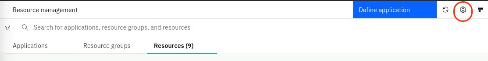

2.  In the **Rules** card select **Configure**. The rules already listed belong to the product or to other students: **leave them alone.**

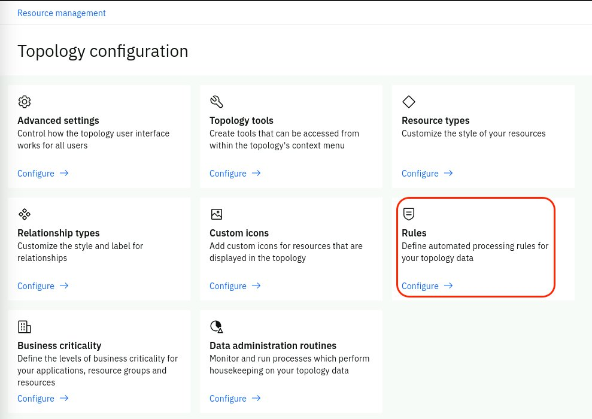

3.  Click the **New** button, select **Merge rule** and select **Start**.
4.  **Rule name:** sNN-InfraApps. Set **Status** to **Enabled**.
5.  **Tokens:** type **\${name}** and click on **Add**.

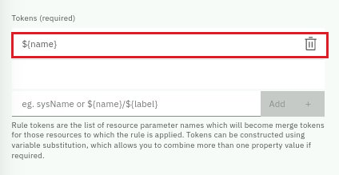

6.  Expand the **Conditions** drop-down:
    - **Observers:** select **File** and click **Add**.
    - **Providers (required on a shared cluster):** type **sNN-infrastructure.txt**, choose (1) **FILE.OBSERVER:sNN-infrastructure.txt** from the list and click (2) **Add**. Repeat for **sNN-application.txt**. Pick only your own two files (the list shows every student's files). This keeps your rule from running on everyone's data.
    - **Resource types:** add **computer**.
    - Leave the Token filter mode and Token filters sections blank.

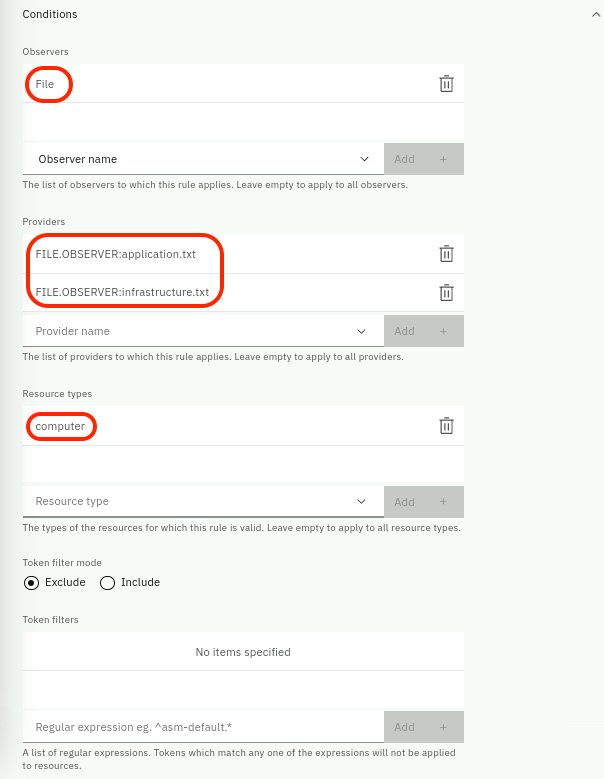

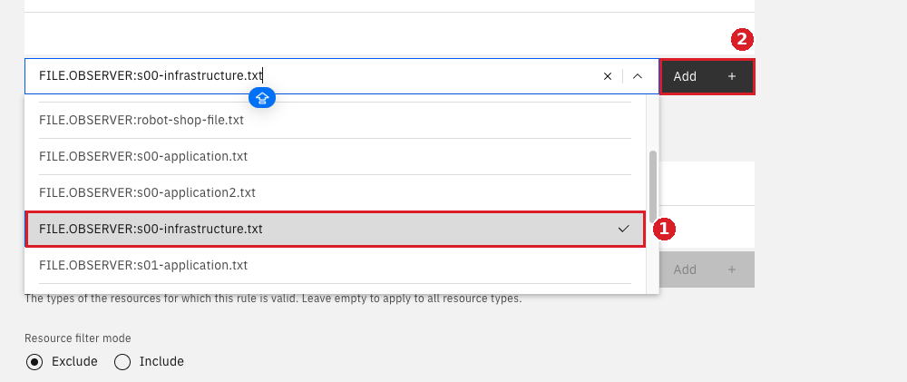

7.  Click **Save**.
8.  From the **Navigation menu** navigate to: **Define → Integrations**. Click on the **Manage observer jobs** tab and click on **Configure, schedule, and manage observer jobs**.

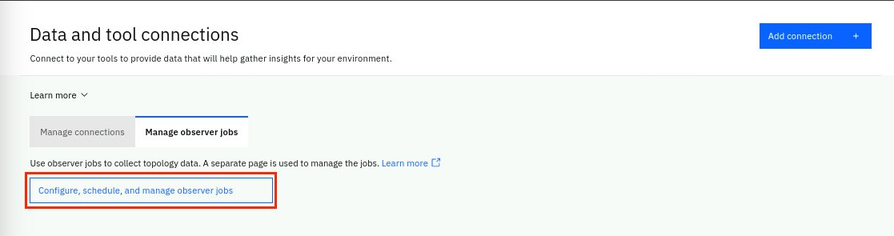

9.  Filter the list by your ID and click **Run** on **sNN-infrastructure** and **sNN-application** only.

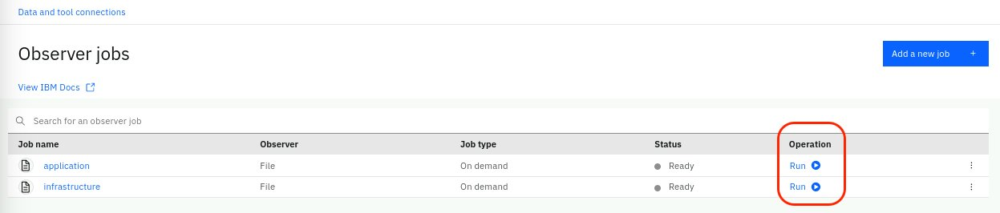

10. Navigate to **Operate → Resource management** and search for **sNN-computer1000**. Now there is just one instance. Click on it, change the (1) hop view to **2** and click (2) **Render**: the router, CPUs, steve, billing and webserver all connect to it.

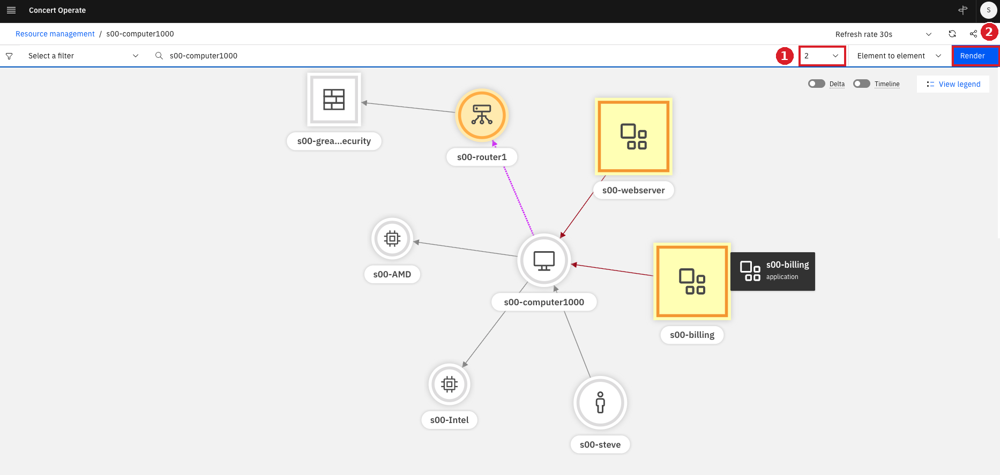

### 5.3 Exact Group Template

Topology group templates create groups of resources. Resource groups make it easier to find and visualize collections of related resources, and they enable alert correlation over resources in the same group. An **exact** template builds a single group of resources centered on a specified seed resource.

> **Why this matters:** A resource group tells Concert Operate "alerts on these resources belong together". An exact template builds one fixed group around one resource you choose, here your router and what is directly connected to it. Turning on Alert correlation is what makes the group useful in Section 8 (Topological Correlation).

1.  In the **Resource management** page, click on the **Resource group templates** icon in the top-right.

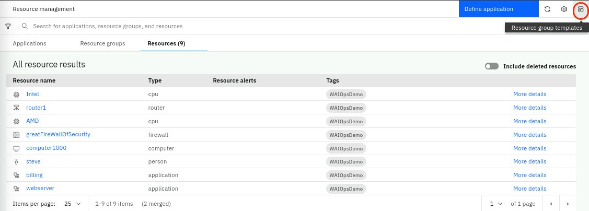

2.  Click on **Create a new template**, select **Exact template** and click **Start**.

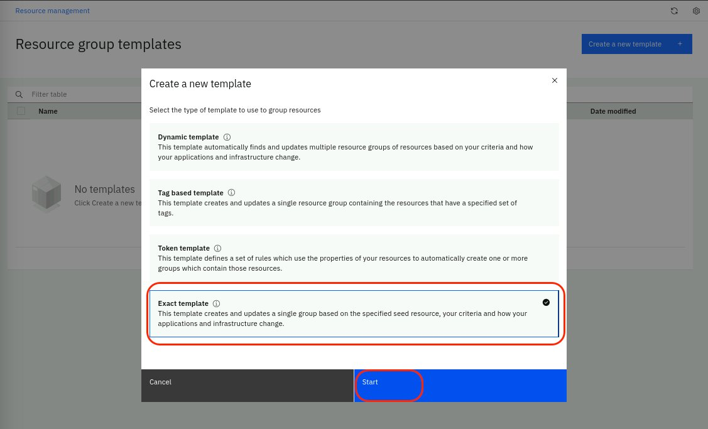

3.  Configure the template:
    - \(1\) **Template name:** sNN-router1
    - **Resource group type:** network
    - \(2\) **Resource group naming pattern:** type **ROUTER-** in **Name prefix** (leave Name suffix empty). Your group will be called ROUTER-sNN-router1.
    - \(3\) **Alert correlation:** turn on **Correlate alert groups on topologies from this template** (it is off by default). Keep **Time window length** at **900** seconds and **Time window type** at **Rolling**. This is what makes alerts on these resources correlate in Section 8 (Topological Correlation).
    - Leave every other field as it is: Description, Icon, tag, default filter and the two **Disabled** switches. (Copying tags would label your group with LAB-sNN, which later templates use to pick resources.)
    - \(4\) In **Search for a resource to get started**, type **sNN-router1**, hit Enter and choose it.
    - \(5\) Change the view to **1 hop** and click **Render**: router, firewall and computer.

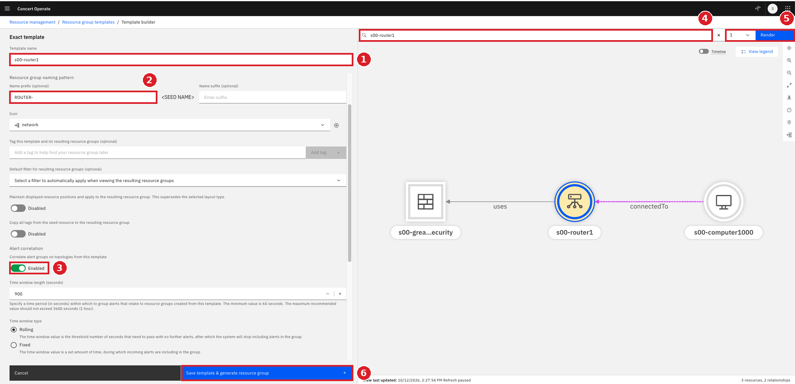

4.  Click (6) **Save template & generate resource group**.
5.  Click on **Resource management**, select the **Resource groups** tab and search for your ID. Click on **ROUTER-sNN-router1**: the group has router, firewall and computer. If a size of 4 is shown, that is correct: sNN-computer1000 is counted twice because it is one resource merged from two files.

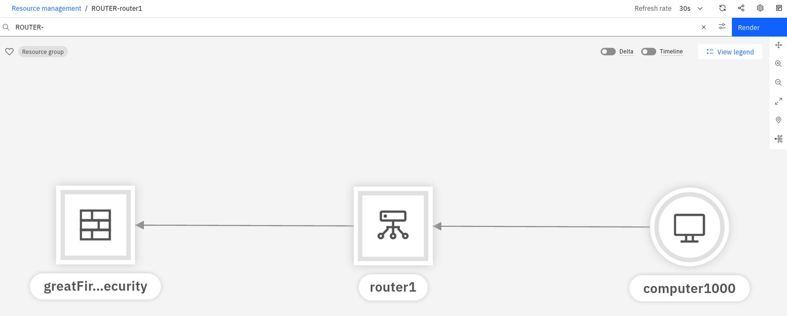

> **Note:** Because event correlation is enabled on this group, alerts on any of these resources are correlated automatically. This is **topological correlation**, which you will test in Section 8 (Topological Correlation).

### 5.4 Dynamic Group Template

A **dynamic** template records a recipe from one example and builds a group for every set of resources that matches it. Here the recipe is a computer plus everything that runs on it.

> **Why this matters:** Building groups one by one does not scale. A dynamic template records a pattern (a computer plus the applications that run on it) and builds a group for every match, now and as new computers appear. The LAB-sNN tag limits the pattern to your own computers, because on this shared cluster every student has the same pattern.

1.  In **Resource group templates**, click **Create a new template**, select **Dynamic template** and click **Start**.

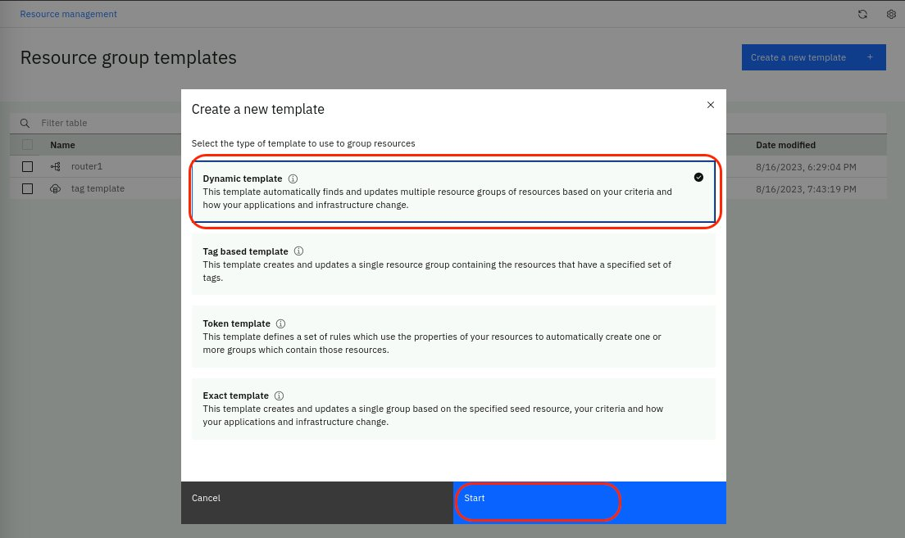

2.  Configure the template:
    - \(1\) **Template name:** sNN-AppServers
    - \(2\) **Resource group type:** compute
    - \(3\) **Maximum number of groups to create:** 20 (required: Save stays grey without it)
    - \(4\) **Name prefix:** APPSERVER-
    - \(5\) **Icon:** compute
    - \(6\) **Alert correlation:** turn on **Correlate alert groups on topologies from this template** (off by default). Keep **900** seconds and **Rolling**.
    - Leave the tag, default filter and **Copy all tags** as they are.
    - \(7\) Search for **sNN-computer1000** and choose it (not sNN-computer1001, which also appears). If you see **two** sNN-computer1000 rows, your merge rule from Section 5.2 (Merge Rules in Action) is not working: fix it first.
    - Right-click on **sNN-computer1000** and select **Follow Relationship → runsOn**. (8) Billing and webserver appear.

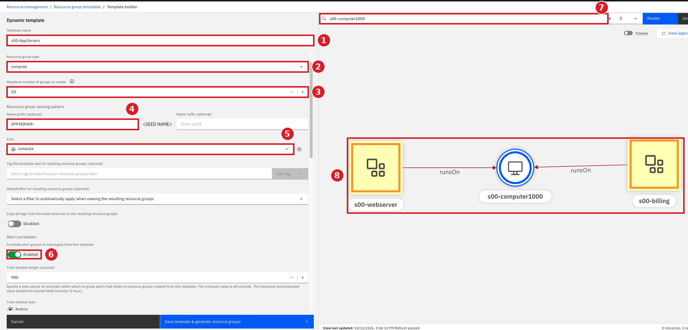

3.  Scroll down on the left side to **Template definition**. In the first block, **Seed: sNN-computer1000**, type **LAB-sNN** (upper case LAB) in (1) **Filter tag (optional)** and click **Add tag**, so that LAB-sNN appears as a tag under the field. This is **required on a shared cluster**: without it, your template matches every student's computers. Leave the tag fields under **Follows relationship** empty.
4.  \(2\) Check the line at the top of Template definition: it must say **2 matching starting template seeds have been found**. A bigger number means the tag is missing; 0 means the tag text does not match.

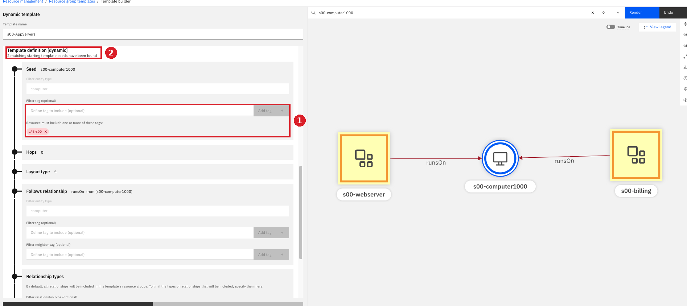

5.  Click **Save template & generate resource groups**.
6.  Under **Preview resource groups** check that exactly **2** groups appear: **APPSERVER-sNN-computer1000** and **APPSERVER-sNN-computer1001**. More than 2 means the LAB-sNN tag is missing: edit the template and add it.

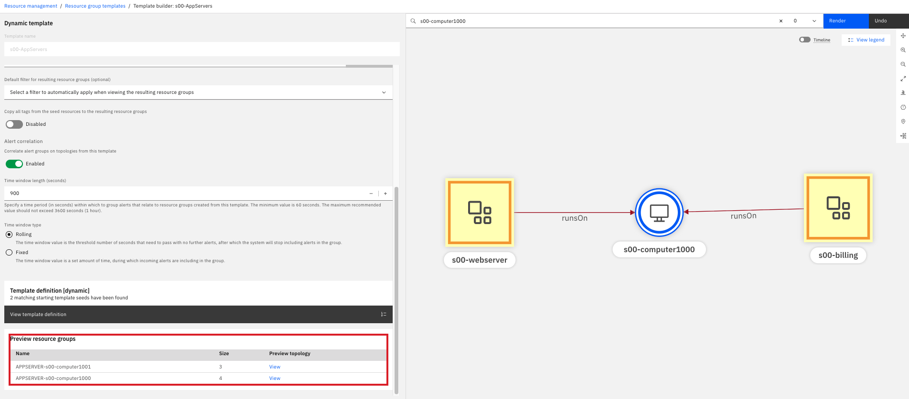

### 5.5 Applications and Business Criticality

An **Application** is a collection of topology resource groups that represent a complete IT solution stack. Alerts impacting resources also surface on the Applications those resources belong to, and the application's **business criticality** helps operations prioritize incidents. Your instructor already added the business criticality presets: **Platinum, Gold, Silver and Bronze** (from highest to lowest).

> **Why this matters:** Operators think in services, not in routers and computers. An application wraps your resource groups into one business service, and its business criticality (Platinum is the highest) tells operations which incidents to work on first.

1.  From **Operate → Resource management**, click the **Define application** button in the top-right.
2.  Search for your ID and select your 3 groups: **ROUTER-sNN-router1**, **APPSERVER-sNN-computer1000** and **APPSERVER-sNN-computer1001**.

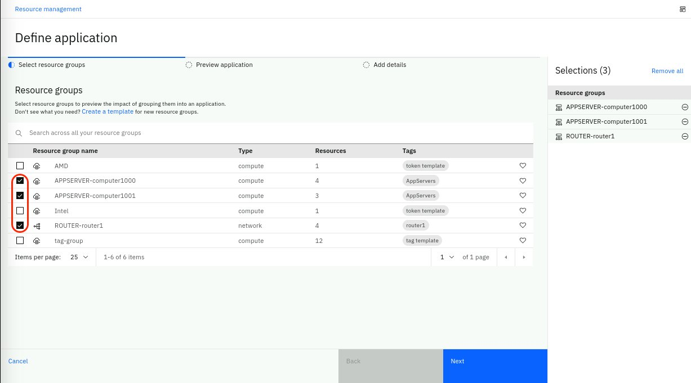

3.  Click **Next** to preview the application: (1) 8 resources and 6 relationships. Click (2) **Next** again to add details.

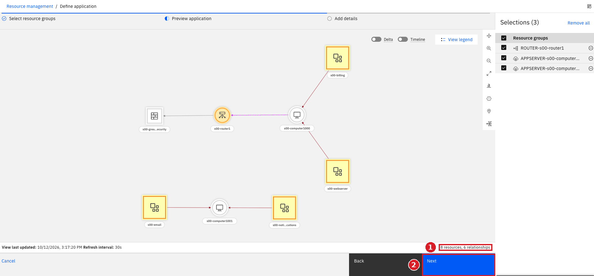

4.  Enter the details:
    - \(1\) **Name:** sNN-Order Capture Backend
    - \(2\) **Icon:** backend. Mark the application as a favorite by clicking on the heart icon.
    - \(3\) **Add tags:** type sNN-orderBackend and hit **Enter** to add the tag. The tag only helps searching, so the screenshot shows a different tag name.
    - \(4\) **Business criticality (required):** open the pull-down and choose **Platinum**.

    **Do not skip Business criticality: without it your application shows no resource alerts in Section 8.2 (Alert Roll-up to the Application).**
5.  Click (5) **Define application**. It appears in the **Applications** tab with its resource count. Check that the **Business criticality** column shows **Platinum** for your application. If it shows "–", click the three dots on your row, select **Edit**, choose Platinum and save.

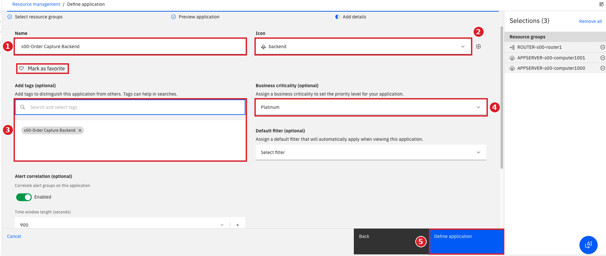

## 6 Scope-based Correlation

Scope-based grouping is based on a basic premise: alerts occurring at "around the same place" and "about the same time" are likely related. You will play the role of the SRE for **sNN-NetCash**, an application deployed in two cloud regions, US-SOUTH and US-EAST (EU-CENTRAL is out of scope). You will first see the alerts ungrouped, then create a policy that groups them by location and application within a 15-minute rolling window.

Your 8 events, all on your own event day:

| Resource             | US-SOUTH               | US-EAST                  | EU-CENTRAL      |
|----------------------|------------------------|--------------------------|-----------------|
| sNN-DB2server2       | /dev/sda1 70% full     | /dev/sda1 90% full       | DB2ERR=667      |
| sNN-Liberty Server 1 | Cannot connect to DB2  | DB rejected connection   | DB unresponsive |
| sNN-NetCash Services | cash-transfer time out | account-balance time out |                 |

> **Why this matters:** A scope-based policy groups alerts that happen in the same place (the scope, here location plus application) within a time window. The product ships preset scope policies, but they group by a single field, such as the alert's resource name, so they would only group repeats on the same server. Your NetCash problem spans three different servers in the same region, so you create your own policy that groups by location and application. On this shared cluster your policy is limited to sNN-NetCash, so it only ever touches your alerts.

Your instructor disabled the product's preset scope-based policies before class, so nothing groups these alerts yet. **Do not turn them back on.**

### 6.1 Submit Events with no Scope-based Policy

> **Why this matters:** You first send the events with no policy in place, so you can see the noise an operator would face: 8 separate alerts for what is really two problems. In Section 6.3 you send the same events with your policy enabled and compare.

1.  In your bastion window, run:

<!-- -->

    ./send-events.sh sNN-scope-events.json

2.  Navigate to **Operate → Alerts**, click **Refresh alerts** and type your ID, **sNN**, in the (1) search bar of the alerts so it only shows your alerts. All 8 alerts are shown, but there is no grouping: the (2) Correlation column is empty.

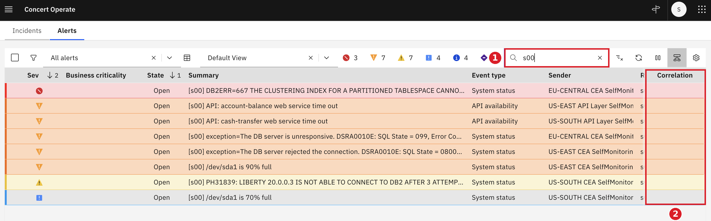

3.  With the search still set to sNN, click the **checkbox at the top-left** to select your 8 alerts, right-click and select **Clear**. Creating the policy in the next step takes long enough for them to close.

### 6.2 Create a Scope-based Event Grouping Policy

1.  Navigate to **Operate → Automations**. On the **Policies** tab click the **Filter** icon (circled), check (1) **Scope-based** and click (2) **Apply**.

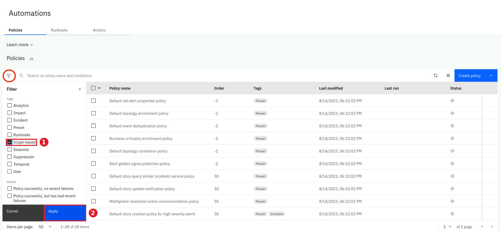

2.  Read only, no need to open it: the list includes **v2 Default scope policy - Correlation on alert resource name...**, which your instructor disabled. As its name says, it groups alerts on the **same resource**. Your alerts are on different servers, so you create your own policy that groups by **location and application**. **Do not open, enable or change the preset scope policies.**

<!-- -->

3.  Click **Create policy** and select the **Group alerts based on scope** tile.
4.  Under **Policy details**: make sure the policy is **Enabled**, set the (1) **Policy name** to **sNN - Group by Location-Application** and change the (2) **Execution order** to **40**. (The screenshot shows an older policy name.)
5.  Under **Policy triggers**, check (3) **Before an alert is created**.

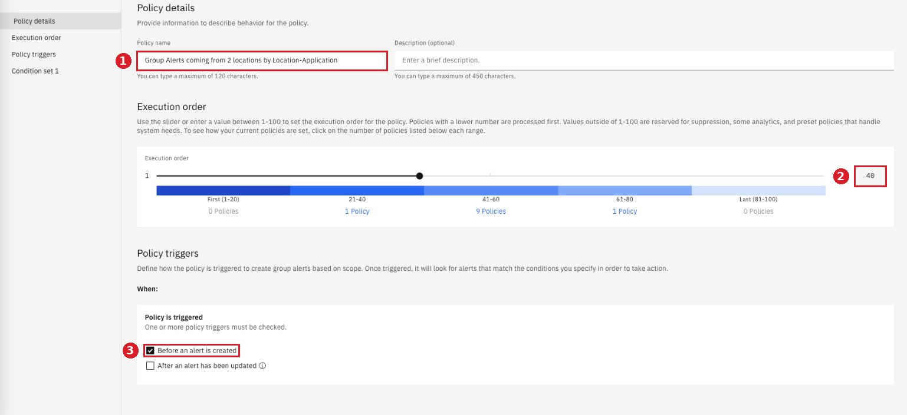

6.  Under **Condition sets**, click (1) **Add condition** and select **Alert property**:
    - \(2\) **Condition 1:** leave **AND** selected. Property **alert.resource.location**, Operator **contains**, Matches **any of**, Values **US-SOUTH** and **US-EAST** (type each in uppercase and select String).
    - \(4\) **Condition 2 (required on a shared cluster):** click (3) **Add alert property condition** and keep **AND**. Property **alert.resource.application**, Operator **equal to**, Matches **only**, Value **sNN-NetCash**. This keeps your policy from grouping other students' alerts, including their baselines.

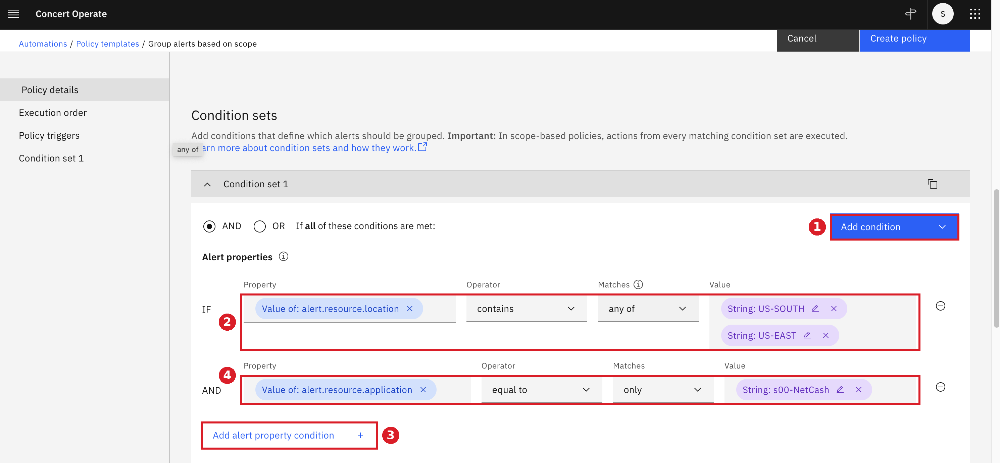

7.  Under **Create a scope-based grouping**, select **resource.location**, type the colon character **:** and select **String: :**, then select **resource.application**. Your ScopeID should read:

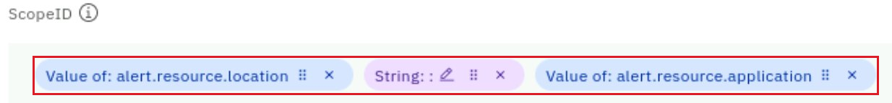

8.  Under **Time window**: type (1) **900** (15 minutes) and select (2) **Rolling**. Alerts are grouped as long as they are not separated by more than 15 minutes.

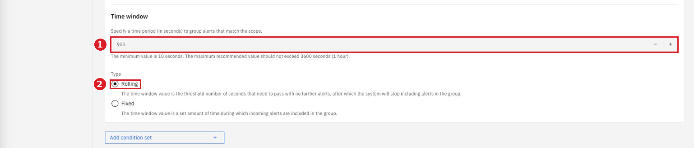

9.  Click **Create policy** on the top-right.

### 6.3 Submit Events with the Scope-based Policy Enabled

1.  In **Alerts**, search for your ID and click **Refresh alerts**. **Wait until no alerts are shown**: your 8 alerts from Section 6.1 must be Closed, not just Clear.

> **Important:** if you resend while your alerts are still in Clear state, the events reopen the old alerts instead of creating new ones, and your policy, which runs when an alert is **created**, never groups them. If that happens, clear them again, wait until none are shown, and resend.

2.  In your bastion window, send the same events again:

<!-- -->

    ./send-events.sh sNN-scope-events.json

3.  Wait a minute, then click **Refresh alerts** with your ID in the search box. You should see 2 groups of 3 alerts (US-EAST and US-SOUTH) and the 2 EU-CENTRAL alerts on their own, because EU-CENTRAL is outside your policy.
4.  \(1\) Click the **chevron** at the left of each **GROUP (3 alerts)** row to expand it. (2) Click the **View correlation** icon in the top-right toolbar. (3) The **Correlation** column now shows the scope-based icon on each grouped alert; the EU-CENTRAL alerts have none.

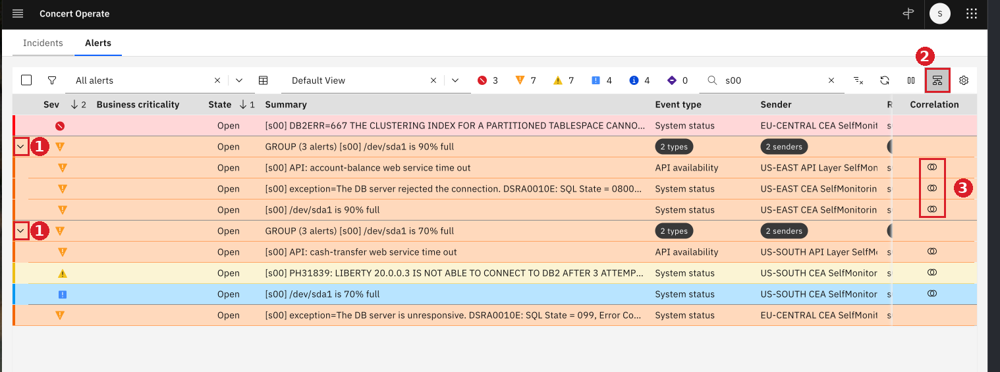

5.  Clear your alerts: (1) make sure the search box still says **sNN**, so only your alerts are listed; (2) click the **checkbox at the top-left** of the list to select all your alerts at once, including the groups; (3) right-click any selected alert and choose **Clear**. No need to clear them one by one. **Never use the select-all checkbox with an empty search box: it would clear every student's alerts.** Leave your policy enabled: it only matches sNN-NetCash, so it will not affect Section 8 (Topological Correlation).

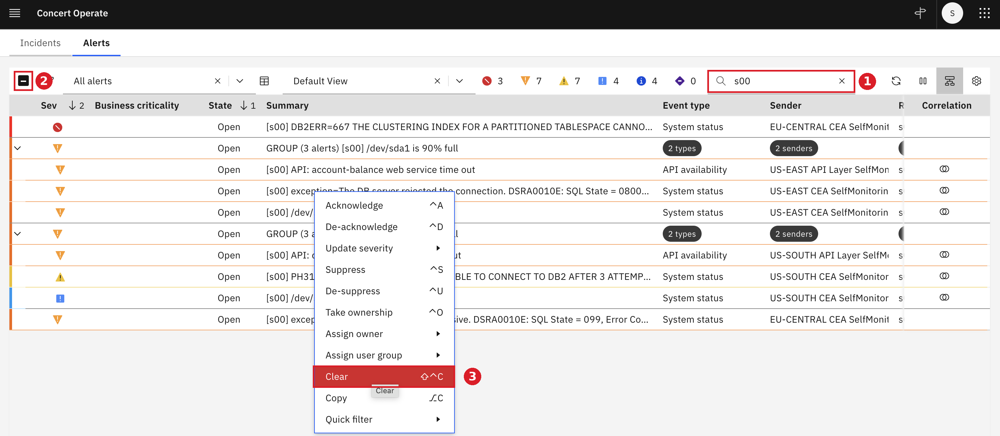

## 7 Temporal Correlation

Temporal grouping is an unsupervised learning algorithm that groups alerts which co-occur over time. When a problem arises, multiple parts of a system are typically impacted. When alerts in different areas co-occur repeatedly, it makes sense to look at them together and treat them as one problem. Temporal grouping generates alert grouping policies that you can review and deploy.

Training takes longer than a lab slot and the model is shared by the whole cluster, so your instructor prepared it before class. You still get your **own** scenario:

- **Your own history:** a small web application, **sNN-myapp**, has four monitored resources: https://sNN-myapp.example.com, sNN-front-end-svc, sNN-newsletter-svc and sNN-newsletters (all under myapp.example.com). Its alert history holds 24 alerts: two pairs of alerts that occurred together on six different days in the last three months. Every student has a copy with their own ID, at different times of day.
- **Model trained and policies deployed:** one training run learned **two policies for every student**. Yours match only your sNN alerts.
- **Your part:** review your two policies, send your 4 events, and watch them group.

> **Why this matters:** Scope and topology need you to describe your environment. Temporal grouping needs nothing: it learns from history which alerts tend to happen together, even when they share no resource, location or topology link.

> **Do not change the model or the policies:** review only in the policy and model pages. Do not click Train, Deploy, Archive or Disable, and do not delete or edit the model or any temporal policy. Other students' temporal policies carry their own ID: leave them alone.

### 7.1 Review your Temporal Policies

1.  Navigate to **Operate → AI model management** and click the **Temporal grouping** tile. The **Summary** page shows the algorithm and how it is trained (training data: (1) past 90 days, (2) manual schedule). On this shared cluster the model was trained for the class before you started, and the (3) **Latest model version**, **Date trained** and **Activity** fields can show a dash: that is expected. The proof that the model is trained is the set of policies it created, which you review next. **Do not click (4) Train model and create policies, and never use Delete in the (5) Danger zone.**

2.  Navigate to **Operate → Automations** and select the **Policies** tab. (1) Click the **Filter** icon, (2) check **Temporal**, (3) click **Apply**. (4) Type your ID, **sNN**, in the search box. (5) Exactly two policies remain, both yours: **\[sNN\] Newsletter service error rate high** and **\[sNN\] Synthetic test failed for \>1min on https://sNN-myapp.example.com**. The other temporal policies belong to other students and to the cluster's demo applications. **Do not edit, disable or delete any temporal policy.**

3.  Click your **\[sNN\] Synthetic test failed...** policy. The slider shows its **Condition set**: (1) **If any condition is met**, with two values of **alert.signature**: your front-end-svc high error rate alert and your synthetic test alert. Both contain sNN, so the policy matches only your alerts. These values were learned from your history, where the two alerts co-occurred. **Then take the following actions**: (2) **Key by policy.id** and (3) **groupV2** put matching alerts that first occur within 60 seconds of each other into one group (the group stays open for up to an hour). **Do not use the (4) Delete or Archive icons at the top of the slider.**

4.  Click **Justification** at the top-right of the slider.

The **Temporal policy details** page shows the history that taught the model this pattern: your synthetic test alert and your front-end-svc error alert, both closed. The bar at the top covers the last three months; each purple mark is a day when the two alerts happened together. **Group instances** lists those past occurrences, one card per day (about six), each with the number of alerts and a mini timeline of how far apart they started.

**Optional, if you have time:** repeat steps 3 and 4 for your **\[sNN\] Newsletter service error rate high** policy. Its page looks like this: (1) the bar at the top spans your history, with a mark for each day the alerts happened together; (2) the same marks appear against each alert in the list; (3) **Group instances** lists each past occurrence with **2 Alerts**; (4) click the arrow on a card to expand it and see the two alerts. The error-rate alert starts first and the "newsletter not received" alert follows about two minutes later, every time: that repeated pattern is what the model learned.

### 7.2 Test your Temporal Policies

1.  In your bastion window, send your 4 temporal events. Their timestamps are 15 seconds apart, newsletter pair first, so each pair falls inside the 60 second window:

<!-- -->

    ./send-events.sh sNN-temporal-events.json

2.  Go to **Operate → Alerts**, click **Refresh alerts** and search for your **sNN**. Wait a minute or two if the alerts are not there yet; the cluster is shared with 30 other students. You see two groups, each with 2 alerts: **GROUP (2 alerts) \[sNN\] High error rate on sNN-front-end-svc...** and **GROUP (2 alerts) \[sNN\] Newsletter service error rate high**.
3.  \(1\) Click the down arrow at the left of each group to expand it. (2) Click the **Correlation** icon at the top right of the alert list to show the Correlation column. (3) Every alert in both groups shows the **temporal** (clock) icon: they were grouped because the model learned from history that they happen together, not because they share a resource, location or topology link. The alerts in each group come from different senders and resources. **First occurrence** shows your own event day (YOUR EVENT DAY in your README), not today; each student has a different day so alerts never mix. **Do not clear or close other students' alerts.**

4.  \(1\) Click one of the alerts inside a group, for example **\[sNN\] Newsletter test email not received...**. The **Alert details** panel opens on the right. (2) Expand **Temporal correlation (1)**. (3) It shows the evidence the model learned from: **First group instance** (a date in your history, shown in your browser's time zone), **Total group instances** (how often the group happened in your history) and **Average instance duration** (how far apart the alerts usually start), plus a calendar of the days it happened. For your Newsletter pair it shows 6 instances, about 2 minutes apart. (4) **More information** opens the same policy justification page you reviewed in 6.1. **Do not click Clear alert in this panel.**
5.  Leave your myapp alerts open; they do not affect Section 8 (Topological Correlation).

**Discuss:** none of these alerts share a resource, a location or a topology group. Only history links them, which is why scope-based and topological correlation would never have grouped them. And because your history is your own, your alerts never join another student's group, even though the same model serves the whole class.

## 8 Topological Correlation

Topological alert grouping groups alerts based on the topology resource groups in which those alerts occur. In Section 2.3 (Warm-up) your network alerts did not correlate. Now that ROUTER-sNN-router1 and APPSERVER-sNN-computer1000 exist with correlation enabled, the same kinds of alerts will.

> **Why this matters:** Now you repeat the warm-up from Section 2.3. The resources exist in topology and belong to groups with alert correlation enabled, so the same kind of alerts are grouped automatically. No policy to write: the topology is the policy.

### 8.1 Validate Topological Correlation

1.  In your bastion window, send the network events again:

<!-- -->

    ./send-events.sh sNN-topology-events-network.json

2.  Navigate to **Operate → Resource management**, click on the (1) **Resource groups** tab and search for your ID. **ROUTER-sNN-router1** now shows 3 alerts in the (2) **Resource alerts** column.

> **Why this matters:** An operator who sees three alerts first wants to know whether they are one problem, and whether something changed. The topology view answers the first: the alerts sit on resources that are linked, inside the group you built in Section 5.3. The Topology activity panel answers the second: it puts alert severity and topology changes on the same timeline, so you can see whether a new link or a configuration change happened just before the alerts started. Here the topology was stable, which points to a failure on the devices rather than a change.

3.  Click **ROUTER-sNN-router1**. The topology view shows (1) the three resources in the group and the links between them from your topology files: sNN-greatFireWallOfSecurity, sNN-router1 and sNN-computer1000. Each carries a badge with the severity of its open alert: **critical** on the firewall (red), **major** on the router (orange), **warning** on the computer (blue). (2) Click **Topology activity** at the bottom left to expand it. (3) **Alert severity breakdown** shows the alerts on this group's resources over the last hour, by severity. Bars of the same height mean the same alerts stayed open; a new problem would show up as a taller bar or a new color. (4) **Topology activity** shows how the topology itself changed in the same hour: **Number of relationships** (green) and **Property changes** (purple). Flat lines mean nothing changed: no link was added or removed and no resource property was edited. (5) **Incidents (0/0)**: the alerts are correlated into one alert group, but no incident has been opened for this resource group; in this section you work with alerts and alert groups. **Do not edit the resource group or its resources from this page.**

4.  Navigate to **Operate → Alerts** and search for your ID, **sNN**. Your three network alerts are in one group, **GROUP (3 alerts) \[sNN\] CPU at 80% utilization**. (1) Click the down arrow to expand it. (2) Click the **Correlation** icon at the top right of the alert list to show the Correlation column. (3) All three alerts show the **topological group** icon: they were grouped because their resources are in your resource group ROUTER-sNN-router1, which has alert correlation enabled (Section 5.3). (4) Your router and computer alerts also show a second icon, **topological path** correlation.

\(1\) Double-click the topological path icon on your **sNN-computer1000** alert. The **Alert details** panel opens. (2) **Topological group correlation (3)** lists the three alerts grouped by your resource group. (3) **Topological path correlation** draws the path that links the alerts: sNN-computer1000 and sNN-router1, each with its alert badge. (4) The link is labelled **connectedTo**, the relationship from your sNN-infrastructure.txt file. (5) **More information** opens the full topology. **Do not click Clear alert in the panel until step 5.**

> **About topological path correlation (Concert Operate 5.1 and later):** **Topological group correlation** needs a resource group built in advance: you built ROUTER-sNN-router1 in Section 5.3 and turned on alert correlation. **Topological path correlation** needs no group. Concert Operate follows the relationships in the topology from one alerting resource to the next (resources that are connected, depend on each other or contain each other) and groups alerts that occur on a connected path within a time window. Each grouped alert links to the path that explains it, so you can see why the alerts belong together. **How it helps:** it correlates across domains without building groups first, for example a network switch failure with alerts on the servers connected to it, or a database error with alerts on the services that depend on it. It also groups less than a large resource group would, because only resources on the path are included. **In your lab:** your computer is **connectedTo** your router, so path correlation links those two alerts. Your router **uses** the firewall; that relationship is not followed as a path here, so the firewall alert is grouped only by your resource group. Both methods work together: the group gives the area, the path explains the cause chain.

5.  Select your 3 alerts, right-click and select **Clear**, so the next test starts clean.

### 8.2 Alert Roll-up to the Application

The next 3 events hit sNN-computer1000, sNN-billing and sNN-webserver: all members of APPSERVER-sNN-computer1000, which belongs to your application.

1.  In your bastion window, run:

<!-- -->

    ./send-events.sh sNN-topology-events-app.json

2.  Navigate to **Operate → Resource management** and click on the **Applications** tab. Your **sNN-Order Capture backend** card and row show (1) **Platinum** and (2)/(3) the **Resource alerts** by severity: 1 critical (web server returning HTTP 503), 1 major (billing batch job), 1 minor (memory at 95%). (4) The alerts roll up to the application and carry its Platinum criticality, which you set in Section 5.5. The list refreshes on its own; if the alerts are not there yet, wait a minute and click the refresh icon.

3.  **Optional:** click the application name to see the impacted resources on its topology.

4.  Navigate to **Operate → Alerts** and search for your ID: one group of 3 alerts with the topological icon.
5.  Clear your alerts: search **sNN**, click the checkbox at the top-left to select them all, right-click and choose **Clear**. **Never use the select-all checkbox with an empty search box.** You have completed the lab.

## 9 Optional Extras: If You Finish Early

If you finish early, try the two remaining template types.

### 9.1 Tag Group Template

A tag-based template builds a single, dynamic resource group containing all resources that have the specified tags. Resources don't have to be connected; they only need the common tag.

1.  In **Resource group templates**, click **Create a new template**, select **Tag based template** and click **Start**.
2.  \(1\) **Template name:** sNN-tag-template. (2) **Resource group type:** compute. (3) **Resource group name:** sNN-tag-group.
3.  Leave **Correlate event groups** **off**, so the group does not absorb your router and app server groups.
4.  Type **LAB-sNN** in (4) **Search for a tag to get started**, hit Enter, check it and click the (5) **Resources** tab: all 11 of your resources. (The screenshot shows the original lab tag.)

5.  Click **Save template & generate resource group**. The group sNN-tag-group appears under **Resource groups**.

### 9.2 Token Group Template

A token template builds groups of resources from a property value. Here it creates one group for each CPU manufacturer.

1.  In **Resource group templates**, click **Create a new template**, select **Token template** and click **Start**.
2.  **Template name:** sNN-token-template. **Resource group type:** compute. Enable **Correlate event groups**.
3.  **Rule name:** sNN-CPU rule. **Tokens:** type **\${name}** and click **Add**.
4.  Under **Conditions**: Observers **File**; **Providers FILE.OBSERVER:sNN-infrastructure.txt (required on a shared cluster)**; Resource types **cpu**.

5.  Click **Add rule**, then **Save template**.
6.  Rerun your **sNN-infrastructure** observer job. Two new groups appear: **sNN-Intel** and **sNN-AMD**.

## 10 Lab Recap

Congratulations if you made it here! You correlated the same kind of noise three ways, each from a different source of knowledge:

| Method      | What links the alerts                           | What you built                                                                            |
|-------------|-------------------------------------------------|-------------------------------------------------------------------------------------------|
| Scope-based | Same location and application within 15 minutes | Your policy, sNN - Group by Location-Application                                          |
| Temporal    | Alerts that occurred together in the past       | Nothing to build: your 2 policies came from the instructor's training on your own history |
| Topological | Same topology resource group                    | Topology files, merge rule, ROUTER- and APPSERVER- groups                                 |

**Event Management** is a core feature of Concert Operate: it consumes IT Ops events from multiple sources and applies advanced noise reduction, including classification, deduplication, correlation and suppression.

A **real-time, unified Topology View** lets you visualize topology changes over time, see anomalous alerts in context, and correlate alerts based on the impacted topology resources. Applications then roll alerts up to a business service with a business criticality level such as Platinum, which is what lets operations rank incidents by business impact.

## 11 Troubleshooting

| Symptom                                                                   | Fix                                                                                                                                                                                 |
|---------------------------------------------------------------------------|-------------------------------------------------------------------------------------------------------------------------------------------------------------------------------------|
| The sender prints FAILED or HTTP 401 or 403                               | Ask the instructor: the webhook settings in your kit need checking.                                                                                                                 |
| "lab.env is not filled in yet"                                            | Your kit was not prepared. Ask the instructor.                                                                                                                                      |
| "This kit belongs to sNN"                                                 | You are sending a file from another student's kit. Use your own.                                                                                                                    |
| ssh or scp rejects your password                                          | Use studentNN and the password on your sign-in slip. If it still fails, ask the instructor.                                                                                         |
| No alerts after sending                                                   | The cluster is shared, so alerts can take a minute or two to appear. Wait, click Refresh alerts, then check that the search box contains your ID.                                   |
| Your resent scope events are not grouped                                  | The old alerts were still in Clear state and were reopened. Clear them, wait until searching your ID shows no alerts, then resend.                                                  |
| Two sNN-computer1000 after the merge                                      | Check the merge rule's providers, then rerun both jobs.                                                                                                                             |
| The dynamic template shows many groups                                    | The LAB-sNN seed tag is missing. Edit the template and add it.                                                                                                                      |
| The scope test shows no groups                                            | Check that condition 2 says sNN-NetCash, and that the Section 6.1 (Submit Events with no Scope-based Policy) alerts had closed before you resent.                                   |
| Resource alerts shows "–" for your application                            | Business criticality was not set in Section 5.5. Edit the application and choose Platinum, clear your three app alerts, wait until they are Closed, then send the app events again. |
| The temporal policy page says "No group instances in selected time range" | Ask the instructor: the policy evidence step was not run after the model was trained.                                                                                               |
| The temporal test shows 4 single alerts                                   | Check that the search shows exactly two \[sNN\] temporal policies, both enabled. If not, ask the instructor. If they are there, wait 2 minutes and send the file again.             |
| You see other students' objects                                           | Expected on a shared cluster. Filter by your ID and **leave theirs alone.**                                                                                                         |

## 12 Feedback section

Use this section to provide feedback on the lab.

## 13 Lab Reference Materials

### 13.1 Concert Operate Documentation

IBM Concert Operate 5.2.0: https://www.ibm.com/docs/en/concert-operate/5.2.0

Setting up training for temporal grouping:  
https://www.ibm.com/docs/en/concert-operate/5.2.0?topic=algorithms-temporal-grouping

Data retention: https://www.ibm.com/docs/en/concert-operate/5.2.0?topic=compliance-data-retention

### 13.2 IBM TechXchange Community

Blogs (search for 'aiops'): https://community.ibm.com/community/user/browse/blogs

### 13.3 Big Blue Helps on YouTube

https://www.youtube.com/@BigBlueHelps

---

## Notices and disclaimers

© 2026 International Business Machines Corporation. No part of this document may be reproduced or transmitted in any form without written permission from IBM.

U.S. Government Users Restricted Rights: use, duplication or disclosure restricted by GSA ADP Schedule Contract with IBM.

This document is current as of the initial date of publication and may be changed by IBM at any time. Not all offerings are available in every country in which IBM operates.

Information in these presentations (including information relating to products that have not yet been announced by IBM) has been reviewed for accuracy as of the date of initial publication and could include unintentional technical or typographical errors. IBM shall have no responsibility to update this information.

This document is distributed "as is" without any warranty, either express or implied. In no event, shall IBM be liable for any damage arising from the use of this information, including but not limited to, loss of data, business interruption, loss of profit or loss of opportunity. IBM products and services are warranted per the terms and conditions of the agreements under which they are provided. The performance data and client examples cited are presented for illustrative purposes only. Actual performance results may vary depending on specific configurations and operating conditions.

IBM products are manufactured from new parts or new and used parts. In some cases, a product may not be new and may have been previously installed. Regardless, our warranty terms apply.

Any statements regarding IBM's future direction, intent or product plans are subject to change or withdrawal without notice.

Performance data contained herein was generally obtained in a controlled, isolated environments. Customer examples are presented as illustrations of how those customers have used IBM products and the results they may have achieved. Actual performance, cost, savings or other results in other operating environments may vary.

References in this document to IBM products, programs, or services does not imply that IBM intends to make such products, programs or services available in all countries in which IBM operates or does business.

Workshops, sessions and associated materials may have been prepared by independent session speakers, and do not necessarily reflect the views of IBM. All materials and discussions are provided for informational purposes only, and are neither intended to, nor shall constitute legal or other guidance or advice to any individual participant or their specific situation.

It is the customer's responsibility to ensure its own compliance with legal requirements and to obtain advice of competent legal counsel as to the identification and interpretation of any relevant laws and regulatory requirements that may affect the customer's business and any actions the customer may need to take to comply with such laws. IBM does not provide legal advice or represent or warrant that its services or products will ensure that the customer follows any law.

## Notices and disclaimers (Continued)

Questions on the capabilities of non-IBM products should be addressed to the suppliers of those products. IBM does not warrant the quality of any third-party products, or the ability of any such third-party products to interoperate with IBM's products. IBM expressly disclaims all warranties, expressed or implied, including but not limited to, the implied warranties of merchantability and fitness for a purpose.

The provision of the information contained herein is not intended to, and does not, grant any right or license under any IBM patents, copyrights, trademarks or other intellectual property right.

IBM, the IBM logo, and ibm.com are trademarks of International Business Machines Corporation, registered in many jurisdictions worldwide. Other product and service names might be trademarks of IBM or other companies. A current list of IBM trademarks is available on the Web at "Copyright and trademark information" at: www.ibm.com/legal/copytrade.shtml.
